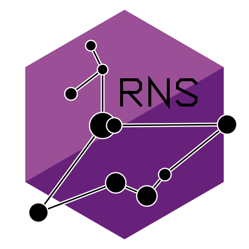

[](https://github.com/dennispayne/DotReticulum/actions/workflows/build.yml) [](https://github.com/dennispayne/DotReticulum/actions/workflows/test.yml) [](https://github.com/dennispayne/DotReticulum/actions/workflows/github-code-scanning/codeql) [](https://github.com/dennispayne/DotReticulum/actions/workflows/codeql.yml)


<p align="center">
  
</p>

# DotReticulum

DotReticulum is a native C# / .NET 10 implementation of the [Reticulum Network Stack](https://reticulum.network) (RNS). It is built to interoperate with the Python reference implementation, so that a .NET node can discover, link with, route for and exchange data with upstream Reticulum nodes.

The goal is high-fidelity feature and behavioral parity with the pinned upstream RNS repository. DotReticulum is written as idiomatic native .NET, not as a line-by-line translation of the Python code.

> [!WARNING]
> DotReticulum is an **experiment in having an LLM build a Reticulum implementation**. It is as much about developing skills in AI agent wrangling, and using CI to improve coding outcomes, as it is about doing odd things in .NET just to see whether they work. Almost all of its code, tests and documentation were written by AI coding agents under human direction. It is experimental, audited as much as this human is capable of (that is, not nearly enough), and **not** for production or security-critical use. Be careful with it.
>
> It is **not** an official, endorsed or community-recognized Reticulum implementation, and it is not the work of the Reticulum project or its maintainer. Do not treat it as a known-good implementation. Those are listed in the [upstream README](https://github.com/markqvist/Reticulum#community-implementations).
>
> The upstream project takes a strict but fair view of LLM-generated implementations, documentation and licensing claims. See the [Brandolini's Reference](https://reticulum.network/manual/brandolinis.html) chapter of the manual. DotReticulum acknowledges that position and makes no attempt to influence it, to seek recognition, or to claim anything on upstream's behalf. The upstream author's opinions are shared here, and this project is a good-faith effort to comply with them.
>
> In keeping with that position, this project keeps the [Reticulum License](LICENSE) and its copyright notice intact, and does not relicense or assert its own license over derived work. Compatibility claims here are exactly as strong as the recorded evidence, and no stronger.

## Read the documentation

The DotReticulum documentation lives in the [docs](docs/README.md) folder and is organized like the upstream manual: getting started, using the utilities, interfaces, building networks, protocol building blocks and compatibility. Start with the [documentation index](docs/README.md).

For Reticulum itself, read the upstream [Reticulum manual](https://reticulum.network/manual/). It is the authoritative description of the protocol and its concepts, and DotReticulum's documentation assumes you are familiar with it.

## Notable features

- Wire-compatible identities, destinations, packets, announces (including ratchets), paths, links, requests, resources, Channel and Buffer
- Multi-hop transport and the `rnsd` daemon, with shared instances, management and discovery
- Interfaces for UDP, TCP client and server, serial, Auto, Backbone, Pipe, KISS and AX.25, RNode, Multi-RNode, I2P, Weave and Local, with IFAC authentication
- The upstream utility set as one NativeAOT executable: `rnsd`, `rnstatus`, `rnpath`, `rnprobe`, `rnid`, `rncp`, `rnx`, `rnsh` and `rnodeconf`, plus `rngit`, `git-remote-rns` and `rngcs` for Git over Reticulum
- Idiomatic, trimming- and NativeAOT-friendly .NET, with asynchronous I/O, cancellation, bounded resource use and no reflection-based serialization

LXMF (DotLXMF) and a .NET-specific telemetry tool (DotTelemetry) live in the separate [DotReticulum.Ecosystem](https://github.com/dennispayne/DotReticulum.Ecosystem) repository.

These features are a target, not a claim of complete parity. See [Compatibility](#compatibility) for what has actually been verified.

## Reference implementation

The Python code in the upstream repository is the Reference Implementation of Reticulum. Together with its manual, it defines the Reticulum Protocol. DotReticulum tracks the reference; it does not replace it.

- **Primary home.** Reticulum hosts its own repository on the Reticulum network, retrievable with `rngit` (Git over Reticulum) at `rns://7649a50d84610232d1416b41d2896aff/reticulum/reticulum`. DotReticulum takes its reference pins from this source, retrieved with its own .NET `rngit` client.
- **GitHub mirror.** [github.com/markqvist/Reticulum](https://github.com/markqvist/Reticulum) is a public mirror of that repository ("all development is happening elsewhere"). It is an easy place to browse the upstream code. DotReticulum uses it only as a secondary comparison source, never as the origin of a new reference pin.
- **Manual.** [reticulum.network/manual](https://reticulum.network/manual/).

The current target is **RNS 1.5.7**, upstream commit `a29bfb51c468945c96a1ee22cae0114e993e2391`. The Python reference environment used by the test harnesses also pins LXMF 1.2.1; LXMF itself is implemented in DotReticulum.Ecosystem.

## Installation

Published packages contain one native executable per tool, so you run `rnsd`, not `DotReticulum.Applications rnsd`. No .NET runtime is needed to run them. Releases provide portable ZIPs; the release workflow also builds native Windows, Linux and macOS installers. The installers make system-wide changes, while the separate local installation script leaves `PATH` for you to edit. See [Installing the utilities](docs/installation.md) for locations, removal and limitations.

To run a utility straight from source:

```sh
dotnet run --project src/DotReticulum.Applications -- rnsd --help
```

## Building from source

Building requires the .NET 10 SDK, pinned in `global.json`. NativeAOT publishing also needs the platform's native toolchain: MSVC build tools on Windows, `clang` and `zlib1g-dev` on Linux, or the Xcode tools on macOS.

```sh
dotnet build DotReticulum.slnx -c Release
dotnet test DotReticulum.slnx -c Release
dotnet publish src/DotReticulum.Applications/DotReticulum.Applications.csproj -c Release -r <rid> -p:ILLinkTreatWarningsAsErrors=true -p:IlcTreatWarningsAsErrors=true
```

`<rid>` is `win-x64`, `linux-x64` or `osx-arm64`. The default test suite needs no Python. Live tests are opt-in and need the pinned reference; see the [contributing guidance](.github/CONTRIBUTING.md). CI builds and tests on Windows, Linux and macOS, and on each it runs a NativeAOT publish with an encrypted multi-megabyte resource round trip.

The solution is split into these projects:

| Project | Responsibility |
| --- | --- |
| `src/DotReticulum.Core` | Identities, wire packets, destinations, packet-interface contract, bounded interface manager |
| `src/DotReticulum.Crypto` | Ed25519, X25519, HKDF, Reticulum tokens |
| `src/DotReticulum.Transport` | Announces, routing, links, resources |
| `src/DotReticulum.Interfaces` | Interface implementations |
| `src/DotReticulum.Applications` | Client runtime and the command-line utilities |

Raw Curve25519 uses Bouncy Castle, because .NET has no portable raw Ed25519/X25519 API. Everything else uses `System.Security.Cryptography`. Reticulum tokens are binary `IV || ciphertext || HMAC`, not standard Fernet.

## Compatibility

In this project, "live" means a real, unmodified Python reference node in the pinned environment. Unit vectors and loopback tests are not live interoperability. The [contract reference](docs/compatibility-contracts.md) gives the status and evidence for each upstream contract, and open gaps are tracked in [TODO.md](TODO.md).

CI runs a shared Compatibility suite: the same upstream-advertised acceptance scenarios, executed against Python RNS and against the native .NET candidates on Linux, macOS and Windows. Multi-node scenarios keep upstream as the fixed peer, with upstream-to-upstream as the baseline, and each .NET candidate fetches the reference with its own `rngit`. Each result row is a real Pester test outcome, not a calculated verdict. See [How compatibility is tested](docs/compatibility-contracts.md#how-compatibility-is-tested) for the details.

This is bounded evidence, not comprehensive parity. For example, the Channel case covers Buffer message encoding, not the general reader and writer APIs, loss or soak, and the routing cases do not establish alternate routes, RF or impaired meshes. Windows `rncp` peer cases disclose a file-retention workaround, described in [Contributing](.github/CONTRIBUTING.md#moving-to-a-new-upstream-release).

| Area | Status |
| --- | --- |
| Crypto, identities, tokens, packets, destinations | Reference-generated vectors, including malformed and boundary input; exercised live |
| UDP, TCP client and server, HDLC | Live against Python in both directions |
| Announces, ratchets, paths, routing, `rnsd` | Live with Python and .NET transports in both directions, including IFAC, a rate-limited latent link and reconnects |
| Runtime configuration, shared instances, management, discovery | Both roles tested against Python; persistence and restart covered |
| Transport probes and configured packet proofs | Observed at actual-primary startup. Windows NativeAOT: implicit and explicit receipts in both directions, a native transport hop, refused links and abrupt identity-preserving restart. New Linux replay and other bearers remain unverified; see [rnsd](docs/rnsd.md) |
| Create-only filesystem publication | Windows NativeAOT identities: concurrent creation and restart at long Unicode local and loopback UNC paths, including extended prefixes, without a long-path manifest. Linux native regression verified. See [runtime state](docs/runtime-state.md) |
| Links, requests, resources, Channel, Buffer | Live in both directions with multi-megabyte payloads, loss, retries and teardown recovery |
| Auto, Backbone, Pipe, KISS, RNode, Weave, I2P | Software and process tests; live Python Auto and Backbone. One Windows RAK4631 passed managed and native receive-only startup and reopen, live configuration and radio-off control. Java I2P: a persisted local-destination bearer restart exchanges DATA for .NET and upstream, and Windows native fresh and reused-configuration probes pass with validated proofs; public-tunnel restart still fails. No over-the-air radio acceptance |
| `rncp`, `rnx` | Live in both directions |
| `rngit`, `git-remote-rns`, `rngcs` | Clone, fetch and push against the pinned Python server; hosting, releases, work documents and signing; verified fetch of the hosted upstream |
| `rnid`, `rnstatus`, `rnpath`, `rnprobe`, `rnsh`, `rnodeconf` | Windows and Linux native-process tests against Python. One Windows RAK4631 passed native USB DFU/reflash and reversible EEPROM persistence and restoration; no RF acceptance |
| Mixed mesh | Measured-window resource loss and retry, and .NET/Python-router recovery. Bounded Windows/Linux/macOS managed endpoint timeout and fresh-session recovery, and Windows managed fresh links through a surviving alternate .NET router after new announcements, in both initiator roles. A separate all-upstream cold-window cancellation is negative evidence, not passing recovery. See [the mesh reference](docs/compatibility-mesh.md) |

| Platform | Status |
| --- | --- |
| Windows x64 | Built, tested and NativeAOT-published; primary development platform |
| Linux x64 | Built, tested and NativeAOT-published; Auto and Backbone live-tested |
| macOS ARM64 | CI builds it, runs the managed suite and an encrypted multi-megabyte native resource transfer; bounded `rnsh` terminal/native flows and actual Python roles verified; packaging not accepted |
| Linux ARM/RISC-V, FreeBSD, Android, iOS | Not verified; a managed build is not platform support |

Current acceptance is limited to the existing Windows, Linux x64 and macOS ARM64 Actions targets and testable software behavior. Physical-device testing and other platform targets are outside the roadmap and remain unverified.

## Versioning

A DotReticulum version is **the upstream RNS release it targets plus a build number**: `1.5.7.<height>`.

- The first three components are the upstream RNS version, entered by hand in [`version.json`](version.json). They change only when the project's reference moves to a new upstream release.
- The last component is the git height from [Nerdbank.GitVersioning](https://github.com/dotnet/Nerdbank.GitVersioning): the number of commits since `version.json` last changed. It rises with every commit and resets when the upstream number changes.
- Tool `--version` output reports the upstream RNS version the tool is compatible with ("reference RNS 1.5.7").

So `1.5.7.42` is the forty-second build aimed at RNS 1.5.7. A version number names the target, not completed parity. To move to a newer upstream, see [Moving to a new upstream release](.github/CONTRIBUTING.md#moving-to-a-new-upstream-release).

### Releases

A release is a `v<version>` tag, such as `v1.5.7.42`, on `main`. Create it with `pwsh tools/New-ReleaseTag.ps1` and push it. The [Release workflow](.github/workflows/release.yml) builds NativeAOT ZIPs and platform installers for `linux-x64`, `win-x64` and `osx-arm64`, and attaches them and SHA-256 checksums to a GitHub release. A manual run builds artifacts without publishing a release.

Each ZIP contains the staged output of `tools/Invoke-DotReticulumPackaging.ps1`; the installers use the same staged files. Installers are unsigned, and the macOS package is not notarized. Existing releases are not changed retroactively. Platform support is only as strong as the recorded evidence; see [installation](docs/installation.md).

## Contributing

Contributions are welcome. Please read the [contributing guidance](.github/CONTRIBUTING.md) first. The [development history](.github/development-history.md) is a condensed record of past work and verification evidence, and [TODO.md](TODO.md) is the active checklist.

See the [accessibility guidance](docs/accessibility.md) for accessibility goals, known limitations and how to report problems.

## License

DotReticulum is released under the [Reticulum License](LICENSE), copied verbatim from upstream. The license adds restrictions on harmful systems and AI-training datasets that are not part of MIT, so this project is not MIT-licensed.
