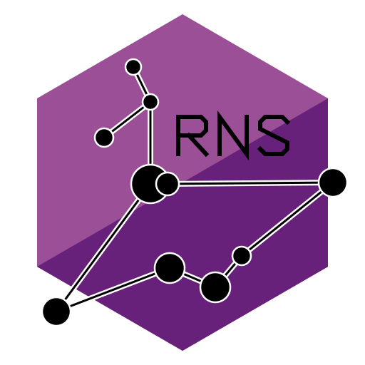

<p align="center">
  
</p>

# DotReticulum

An **LLM-assisted learning project**: an experimental native C# / .NET 10 implementation of the [Reticulum Network Stack](https://reticulum.network), aiming for wire compatibility with the Python reference implementation. It was produced with AI assistance, is not an official or community-recognized Reticulum implementation, and is not endorsed by the Reticulum project or its maintainer. Do not use it for production or security-critical purposes.

Compatibility claims here are exactly as strong as the recorded evidence; see the status table and [development history](.github/development-history.md). Phase progress is tracked in [plan.md](plan.md).

The roadmap targets high-fidelity feature and behavioral parity with the pinned upstream RNS repository, using idiomatic, well-architected native .NET rather than a line-by-line Python translation. It covers upstream runtime behavior, interfaces and bundled utilities, not just wire formats. Audio/video extensions are out of scope; existing LXMF and .NET-specific telemetry remain supported but their expansion is separate from RNS parity.

Our authoritative reference upstream is [`rns://7649a50d84610232d1416b41d2896aff/reticulum/reticulum`](rns://7649a50d84610232d1416b41d2896aff/reticulum/reticulum), retrieved through our .NET `rngit` client. Live tests pin its commit `a29bfb51c468945c96a1ee22cae0114e993e2391` (RNS 1.5.7); GitHub is a secondary mirror. Stored vectors retain their original generation provenance.

P0's hosted-upstream gate is complete: our NativeAOT .NET client fetched missing Git objects over a public Reticulum path, verified the resulting repository and compared it with the GitHub reference. This was an incremental fetch seeded with historical GitHub objects, not a full download from scratch. Evidence and remaining limits are in the [development history](.github/development-history.md).

## Architecture

| Project | Responsibility |
| --- | --- |
| `src/DotReticulum.Core` | Identities, wire packets, destinations, packet-interface contract and manager |
| `src/DotReticulum.Crypto` | Ed25519, X25519, HKDF, Reticulum tokens |
| `src/DotReticulum.Transport` | Announces, routing, links, resources |
| `src/DotReticulum.Interfaces` | `IPacketInterface` bearers: UDP, TCP client/server (HDLC), serial (HDLC); bounded `PacketInterfaceManager` lives in Core |
| `src/DotReticulum.Lxmf` | LXMF messages, stamps and a router-lite (opportunistic/direct/Resource delivery, receipts, retry queue); see [docs/lxmf.md](docs/lxmf.md) |
| `src/DotReticulum.Applications` | `ReticulumNode` client runtime, RNS utility implementations (physical device acceptance outstanding), telemetry and Git tools |

Production projects enable trimming and NativeAOT analysis. Raw Curve25519 uses Bouncy Castle because .NET has no portable raw Ed25519/X25519 API; AES, HMAC, SHA and HKDF use `System.Security.Cryptography`. Reticulum tokens are binary `IV || ciphertext || HMAC`, not standard Fernet tokens.

## Build and test

```sh
dotnet build DotReticulum.slnx -c Release
dotnet test DotReticulum.slnx -c Release
dotnet publish src/DotReticulum.Applications/DotReticulum.Applications.csproj -c Release -r <rid> -p:ILLinkTreatWarningsAsErrors=true -p:IlcTreatWarningsAsErrors=true
```

PowerShell 7 entry point: `pwsh -NoProfile -File tests/run-tests.ps1 -Pester`.
Pester 5.7.1+ covers tooling and separate-process CLI flows, including an
authenticated multi-megabyte rncp send/fetch. See [CONTRIBUTING.md](CONTRIBUTING.md)
for dependencies, coverage, live-reference and published-native options.

## Quickstart

```sh
dotnet run --project src/DotReticulum.Applications -- --help
dotnet run --project src/DotReticulum.Applications -- rnid --generate identity
dotnet run --project src/DotReticulum.Applications -- rnid --show identity
dotnet run --project src/DotReticulum.Applications -- rnsd --exampleconfig > rnsd-config   # then place as <dir>/config
dotnet run --project src/DotReticulum.Applications -- rnsd --config <dir>
dotnet run --project src/DotReticulum.Applications -- rncp -l -a <identity hash> -s <dir> --config <dir>   # receive files
dotnet run --project src/DotReticulum.Applications -- rncp <file> <destination hash> --config <dir>       # send a file
dotnet run --project src/DotReticulum.Applications -- rnx -l -a <identity hash> --config <dir>            # remote commands
dotnet run --project src/DotReticulum.Applications -- telemetry daemon --config <dir>
```

See [docs/rnsd.md](docs/rnsd.md) for daemon configuration, [runtime operations](docs/runtime-operations.md) for shared instances, management, discovery and blackholes, [runtime state](docs/runtime-state.md) for persistence, [docs/rncp-rnx.md](docs/rncp-rnx.md) for rncp/rnx, [docs/telemetry.md](docs/telemetry.md) for telemetry and [docs/rngit.md](docs/rngit.md) for Git transfers, hosting, collaboration, presentation and signing.

Parity 7 utility contracts and current limitations are documented separately for
[rnid](docs/rnid.md), [network inspection](docs/network-utilities.md),
[rnsh](docs/rnsh.md), [rnodeconf](docs/rnodeconf.md) and
[upstream placeholders](docs/upstream-placeholders.md). Implementation is in
progress; these documents do not establish completed utility parity.
For local native packages, executable aliases and integrity-checked installation,
see [installation](docs/installation.md). The script does not modify PATH or
install a service.

Identity files hold 64 raw private-key bytes (X25519 then Ed25519). Generation refuses to overwrite. Protect and back up keys; never commit them.

## Interoperability status

These are bounded verified slices, not complete module parity. Parity 3 adds
source-backed runtime configuration, shared instances, management, durable state,
discovery/blackhole services and terminal-host cleanup, including no-subscriber
processing and pending resource/stream settlement. Parity 4 adds transport
mode/path selection, receipt/proof/cache behavior, IFAC, authenticated tunnel
restoration, bounded traffic controls and reconnect/peer isolation. Parity 5
adds bounded application values, signed ratchet reload, authenticated
local delivery, owned request work, streamed multipart resources and upgraded-MTU
traffic. Operational MTUs now follow the path bottleneck, up to the native
524,288-byte ceiling; actual Python mixed-transport flows exercise MTUs 1,024 and
16,384, not every supported size or bearer.
The source-backed inventory and remaining interface, utility and platform acceptance work remain in
[plan.md](plan.md), with source references and acceptance criteria in the
[development history](.github/development-history.md).

Parity 6 is in progress: native Auto, Backbone/Pipe, KISS/AX.25, RNode/Multi,
I2P and Weave bearers are integrated, with source-executed vectors and bounded
failure-path tests. Real Linux namespace traffic verifies Python/.NET Auto;
device simulators do not establish physical serial/radio or Android support.
Auto device disappearance/reappearance and Local decoded-byte accounting,
keepalive and Android sleep-pause policies have focused software regressions.
An authorized RAK RNode answers native read-only USB identification (firmware
1.86, nRF52); this exposed and corrected the serial DTR/RTS default mismatch.
Only one radio is available, so over-air interoperability remains unverified.
Required hardware/platform acceptance and actual I2P restart recovery remain open.

Parity 8 has completed the available Windows/Linux acceptance slice, not full
release certification. Its [source-backed compatibility ledger](docs/compatibility-contracts.md)
separates missing software from unverified platforms/devices and upstream placeholders.
An [impaired mixed-transport mesh](docs/compatibility-mesh.md) verifies lost resource
parts both ways, bounded bearer pressure, reconnects and persisted .NET-router
restart with surviving Python peers. Non-TCP discovery publication, actual bearer
statistics, [packet-specific PHY attribution](docs/packet-phy.md), create-only
publication, active resource leases and shell initialization have focused regressions.
Darwin terminal support, desktop RNode BLE and Android providers are still missing;
macOS execution, I2P restart delivery, broader impaired topologies and physical
acceptance remain open. CI/CD has not started.

| Capability | Evidence / status |
| --- | --- |
| Ed25519, X25519, HKDF, Token, Identity (encrypt/decrypt/sign) | RFC/reference vectors and .NET-to-upstream cross-checks; exercised in live Python encrypted-packet, link and resource tests below |
| Packet, Destination and application values | Reference-generated codecs plus bounded MessagePack extension/timestamp, numeric/map-key, UTF-8 and malformed-input cases. Plain/group/single endpoints, direction/key lifecycle, authenticated local delivery without observers, dynamic announces, selected ratchet metadata and signed persistence/reload. See [endpoint contracts](docs/endpoints.md) and [application values](docs/application-values.md); strict crypto/provider differences are explicit, not compatibility claims for invalid inputs. |
| UDP, TCP client, TCP server interfaces + HDLC framing | Live-verified on loopback against a real Python RNS (pinned upstream): .NET receives and parses Python announces over all three; Python receives .NET-built packets over all three. HDLC vectors generated by executing upstream Python. Opt-in: `DOTRETICULUM_LIVE=1` (see `tests/Interop/live_interfaces_harness.py`) |
| Announce create/validate, ratchets, known-destination recall, announce engine | Reference-generated vectors, upstream validation of .NET announces, and live Python TCP tests in both directions (validate/recall, ratchet encryption/decryption). Multi-hop announce rebroadcast is exercised by the routing tests below. Observer failures are reported without stopping processing. Opt-in: `DOTRETICULUM_LIVE=1` |
| Transport router + `rnsd` (path discovery, modes, announce scheduling, receipts, proofs, cache and recovery) | Source-executed mode/path/rate/queue vectors and bounded failure/concurrency tests. Actual Python transport + .NET transport: bidirectional discovery, encrypted datagrams/proofs, links and teardown; IFAC flow additionally exercises 64 kbit/s, 20 ms one-way latency, one lost announce and TCP reconnect. Published native daemon persists dormant tunnels and restores Python-transport paths after restart without leaf reannounce. UDP/serial impaired multi-hop and physical-radio behavior remain unverified. Opt-in: `DOTRETICULUM_LIVE=1` |
| Runtime configuration, shared instances and management | ConfigObj-style quoting/lists/defaults and precedence, explicit unsupported-setting errors, PATHING/EXTREME logging/rotation and bounded native interactive shell. Native HDLC shared clients and authenticated multiprocessing/MessagePack RPC tested against pinned Python in both roles; allowlisted identified-link remote management in both roles. Separate managed/native processes cover election, wrong keys, physical-interface ownership, persistence and daemon restart/reconnect. Native management is not a Python REPL; Unix abstract sockets/signals remain unverified on Windows. |
| Runtime persistence, discovery and blackholes | Reference-generated serialization/stamp vectors; atomic state publication, signed opt-in ratchet persistence, retain/use/expiry/corruption, forced proof-cache age and authenticated tunnel restoration. Plain/encrypted discovery advertisements and blackhole updates exchange with pinned Python. Linux/Android autoconnect uses native Backbone; other platforms retain the bounded compatible HDLC adapter. Actual Python Backbone live execution is explicitly skipped on Windows. IFAC rejection counters and configured bitrate/MTU are real manager metadata; unavailable PHY measurements remain null. |
| Links, Resources, Channel/Buffer, link-table forwarding | Live Python links, requests and multi-MB resources both ways, directly and through transports. Actual Python transport + .NET transport flows exercise 40-ms bridge RTT, MTUs 1,024/16,384, selective Channel loss/retry both ways, Buffer streams, file-backed multipart resources, exhaustion teardown and fresh-link recovery. Direct Python requests read a streamed 2,200,037-byte response with metadata. Deterministic tests cover sequence wrap/RTT boundaries, slow consumers, cancellation, malformed compression/metadata and mandatory cleanup joins. Native rncp encrypted/compressed roundtrip evidence is recorded in the history. See [resources](docs/resources.md) and [Channel/Buffer](docs/channel-buffer.md) for ownership, limits and intentional API differences. Opt-in: `DOTRETICULUM_LIVE=1`; native tests additionally use `DOTRETICULUM_NATIVE_EXE`. |
| LXMF (`LxMessage`, `LxmRouter`), `rncp`, `rnx`, telemetry | LXMF: reference-generated vectors; live Python `LXMRouter` delivery both ways (opportunistic, direct, 600,000-char Resource), plus separately .NET -> real `lxmd` delivery (including a 200 kB Resource with its transfer limit raised). Propagation sync, tickets and delivery-destination ratchets are not implemented; delivery to lxmd does not prove propagation support. rncp: send/fetch both ways against Python, 3-5 MB byte-identical; reference-side Windows file-move shim disclosed in [docs/rncp-rnx.md](docs/rncp-rnx.md). rnx: live both ways against Python, with authorization tests. Telemetry: .NET-specific format, tested directly and across a .NET hop, no Python peer. Opt-in: `DOTRETICULUM_LIVE=1` |
| Expanded interface coverage (Parity 6, incomplete) | [Auto](docs/auto-interface.md): actual pinned Python/.NET bidirectional raw/IFAC packets, discovery, wrong-key rejection and expiry on owned Linux namespaces/veth. [Backbone/Pipe](docs/backbone-pipe.md): actual Python Backbone discovery/encrypted links on Linux; managed/native Windows Pipe process flows. [KISS/AX.25](docs/kiss-interfaces.md), [RNode/Multi](docs/rnode-interfaces.md), [Weave](docs/weave-interface.md) and [stream/serial](docs/stream-interfaces.md): software/process/device-simulator tests, not physical acceptance. [I2P](docs/i2p-interface.md): actual i2pd SAM persistence and both Python roles pass; native bearer-restart recovery fails on i2pd and Java I2P. [UDP](docs/udp-interface.md) includes independent receive/forward sockets and Windows/Linux truncation boundaries. [Local/Android audit](docs/interface-platforms.md) records corrected accounting/platform policies and unverified mobile-provider/on-device behavior. See history for exact gates; implementation is not full interface parity. |
| Read-only `rngit clone` / `fetch` | Real upstream server tests verify exact refs/HEAD/tree, incremental missing-object retrieval, no-change fetch and error handling. NativeAOT fetched the hosted Reticulum upstream through a public six-hop path; strict Git object checks passed. Bare repositories only, buffered transfers, no publisher/release-signature verification. See [docs/rngit.md](docs/rngit.md) |
| Native `git-remote-rns` (read/write, SHA-1) | Ordinary Git discovers the renamed executable on PATH. Clone/fetch retains branches, Unicode tags, HEAD, remote-tracking refs and local ref ownership. Push adds bundles, existing-object operations, explicit force, deletion and per-ref status against a disposable pinned Python server; helper configuration/identities/aliases are upstream-compatible with documented safety limits. Published-native Windows/Linux execution and exact results are recorded in the [development history](.github/development-history.md). Historical public-network fetch received 11,502 bundle bytes (92 objects) from a disclosed seed; no test pushes target public upstream. See [docs/rngit.md](docs/rngit.md). |
| Native `rngit` repository node | Persistent identity/configuration/aliases/statistics, announcements, blocked peers, inherited group/repository/document permissions, create/fork/mirror and manual/periodic synchronization. Source-generated differential cases, real RNS transfers against the pinned Python server, owned HTTP Git synchronization, restart/concurrency/cancellation checks and ordinary Git against the native host. External Git transports and executable resolvers require explicit operator authorization. Windows x64 and Ubuntu WSL Linux x64 native host-process evidence; see [development history](.github/development-history.md). |
| Git releases and work documents | Release drafts/artifacts/publication/latest/deletion, signed manifests, fetch/offline verification and scoped signed documents/comments/administration. Actual pinned clients and servers exercise both roles over native .NET links; separate-process managed/native CLI tests cover persisted state and failure paths. Embedded signer keys do not establish publisher trust. The actual Python management client's Windows file-retention shim is disclosed in [docs/rngit.md](docs/rngit.md). |
| NomadNet Git pages, templates and media | Repository/tree/blob/history/commit/ref/statistics/release/work pages and downloads; source-generated default Markdown/Micron/rendering cases and native-host page/download flows. Static templates and explicitly authorized bounded executable/editor processes; real FFmpeg/WebP conversion on Windows. Optional Pygments/wcwidth-enhanced rendering and other installed encoder families are not claimed. |
| `rngcs` Git signing | Source-generated SSHSIG/RSG signatures, principal discovery, structural checks, cryptographic verification and author/tagger matching. Real native Git commit/tag signing and bidirectional pinned-reference signature checks; malformed/tampered/wrong-principal cases. This is not an allowed-signers trust database or authenticated publisher discovery. |
| `rnid` | Pinned-reference import/export, detached/current/legacy/embedded signatures, metadata, base256/wrapping and parser vectors. Managed and Windows/Linux NativeAOT separate processes exchange >16 MiB encrypted files with actual Python in both directions, request/retain identities across restart and send authenticated announces. Explicitly authorized bounded editor flows, binary streams and legacy generate/show persist/refuse overwrite. Strict key and resource limits are documented in [rnid](docs/rnid.md). |
| Network utilities | Separate Windows/Linux published-native processes exercise local statistics/path/drop/blackhole management, authenticated remote status/path against native and actual Python nodes, and Python probe replies/loss. Statistics use measured counters, child aggregates and queue depth/pressure; unavailable PHY data is not fabricated, and Local TCP pending writes are distinguished from upstream TX buffers. Integrated software gates pass; see [network utilities](docs/network-utilities.md) and the [verification history](.github/development-history.md). |
| `rnsh` | Actual Python listener and initiator sessions exercise binary streams, deliberate loss, PTY resize, failed spawn, cancellation and fresh-session recovery. Windows/Linux test all eight pipe/terminal combinations and exact terminal-mode restoration; published-native initiators run inside actual terminals. The pinned Python EOF completion defect is independently reproduced and explicitly bounded in tests, not shimmed. Broader topology/macOS acceptance remains open. See [rnsh](docs/rnsh.md). |
| Device and transfer utilities | Windows/Linux native rncp/rnx process tests cover both actual Python listener roles, raw binary output/limits, timeout/spawn/authorization errors and writable-output failures. RNode firmware plans/provisioning/recovery use independent reference vectors and device simulators; published-native safety/signing/placeholder processes run without real firmware or EEPROM mutation. Actual COM8 native identification and EEPROM backup pass; physical mutation/recovery and RF acceptance remain unverified. See [rnodeconf](docs/rnodeconf.md). |
| Compatibility and native installation (Parity 8, incomplete) | Full non-live suites pass on Windows/Linux; both current NativeAOT binaries execute CLI/installation, terminal, encrypted multi-MB resource and tunnel-restart flows. The new managed-router mesh crosses actual Python and .NET transports, drops/retransmits nine selected resource parts and restarts the .NET router with surviving peers. Native packages preserve the exact license and test all dispatcher aliases, Git discovery, collision/integrity rejection and owned-file uninstall. macOS/provider/hardware and broader topology gaps remain explicit in the [compatibility ledger](docs/compatibility-contracts.md); passing these slices is not full parity. |
| Everything else | Not yet implemented; see [plan.md](plan.md) |

## License

Released under the [Reticulum License](LICENSE), copied verbatim from upstream. It adds restrictions on harmful systems and AI-training datasets that are not part of MIT, so this project is not MIT-licensed.
